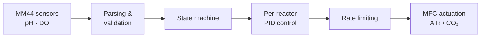
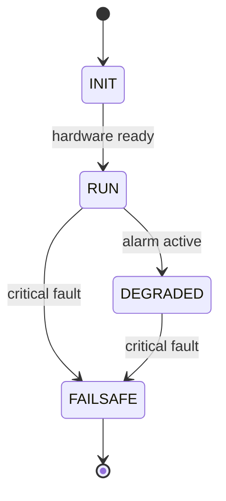

<div align="center">

# 🧪 PHREG: Multi-Reactor pH Controller

**Safety-first pH regulation for up to three independent bioprocess reactors, with real hardware control over Modbus RTU.**


</div>

---

## 📌 Overview

**PHREG** (pH REGulation) is a safety-oriented pH controller for real laboratory and industrial bioprocess environments. It controls up to **three reactors independently**, using industrial instrumentation, and runs headless on a Linux lab or industrial PC.

This is not a simulation or a teaching example. It is written on four assumptions:

| Assumption | What the controller does about it |
|---|---|
| Sensors may fail or deliver stale data | Gas injection stops when pH is missing or stale |
| Actuator communication may be unreliable | Any MFC communication failure forces CO₂ to 0 |
| Operators may enable or disable reactors at runtime | Disabled reactors are isolated in software |
| Safety must override control objectives | Every stage must succeed before it can influence hardware |

---

## ✨ Features

- 🧬 **Three independent reactors**, each with its own PID controller and integrator and no cross-coupling
- 🔀 **Two control modes:** CO₂-only and split-range (default)
- 🛡️ **Explicit state machine** with deterministic fail-safe behaviour
- ⚙️ **PID with anti-windup, deadband and output clamping**
- 🚦 **Rate-limited actuator commands** to prevent valve chatter and pressure shocks
- 💻 **Live runtime CLI** to change setpoints, enable or disable reactors, and shut down safely
- 📊 **JSON telemetry and command interface** for GUI or web dashboards
- 📝 **Per-reactor CSV logging** with monthly rotation and retention cleanup

---

## 🔌 Hardware

| Component | Role |
|---|---|
| **MM44 multi-channel transmitters** | pH and dissolved-oxygen (DO) measurement |
| **Mass flow controllers (MFCs)** | AIR and CO₂ flow control |
| **Modbus RTU over RS-485** | Communication with instruments (USB-RS485 adapter) |
| **Host PC** | Linux lab or industrial PC running Python (headless) |

**Per reactor:** 1 pH input · 1 DO input (monitored, not controlled) · 1 AIR MFC · 1 CO₂ MFC

---

## 🏗️ Architecture

Every stage must succeed before the next stage is allowed to influence hardware.



### State machine



| State | Behaviour |
|---|---|
| **INIT** | Hardware initialization, serial ports opened, MFC control mode set, outputs forced to safe values. No control action allowed. |
| **RUN** | Normal closed-loop PID operation with all safety checks enforced. |
| **DEGRADED** | Partial functionality with active alarms; control continues where it is safe. |
| **FAILSAFE** | CO₂ forced to 0 for all reactors, AIR forced to a safe state, control disabled. The transition is immediate and deterministic. |

---

## 🎛️ Control Strategy

**Error definition**

```
error = measured_pH − pH_setpoint
```

- Positive error: pH too high, so reduce pH
- Negative error: pH too low, so increase pH

**Operating modes**

| Mode | Behaviour | Use case |
|---|---|---|
| **CO₂-only** | AIR held at a fixed baseline; CO₂ is used only to lower pH | Aeration must stay constant |
| **Split-range** *(default)* | CO₂ lowers pH when too high; AIR raises pH when too low | Prevents aggressive CO₂ use and mirrors common bioprocess practice |

**PID features:** configurable gains · anti-windup via integrator clamping · deadband around setpoint · output clamping.
**Rate limiting** is applied after the PID output and before the MFC command.

---

## 🛡️ Safety Philosophy

> **If anything is uncertain, do nothing dangerous.**

| Condition | Guaranteed behaviour |
|---|---|
| Missing or stale pH | No gas injection |
| Any MFC communication failure | CO₂ = 0 |
| Reactor disabled | Isolated in software |
| AIR baseline | Clamped to a minimum safe value |
| Startup and shutdown | Explicit safe sequence |
| Failures | No silent fallbacks |

---

## 🚀 Quick Start

**Requirements:** Python 3.9+ · Linux (recommended) · USB-RS485 adapter

```bash
git clone https://github.com/MaulikItaliya/MultiReactor-pHRegulation-Controller.git
cd MultiReactor-pHRegulation-Controller
pip install pyserial minimalmodbus
python phreg_controller.py
```

**Optional flags**

| Flag | Purpose |
|---|---|
| `--no_mfc` | Run without MFC hardware |
| `--log_enable` | Enable CSV logging |
| `--mm44_ports` | Serial port(s) of the MM44 transmitters |
| `--mfc` | MFC connection settings |

> Run `python phreg_controller.py --help` for the exact argument formats.

---

## 💻 Runtime Interaction

### Command-line interface

Available while the controller is running. Changes apply immediately and safely.

| Command | Description |
|---|---|
| `sp R1 7.40` | Set the pH setpoint for reactor 1 |
| `air R1 20` | Set the AIR baseline for reactor 1 |
| `enable R2 on` / `enable R2 off` | Enable or disable reactor 2 |
| `status` | Print system state |
| `raw on` / `raw off` | Toggle raw MM44 output |
| `q` | Safe shutdown |

### Dashboard JSON interface

| File | Direction | Content |
|---|---|---|
| `/tmp/mm44_latest.json` | Controller → dashboard | System state, active alarms, per-reactor sensor values, actuator commands |
| `/tmp/mm44_cmd.json` | Dashboard → controller | Setpoint, AIR baseline and enable commands |

Example command:

```json
{
  "ts": "2026-02-07T12:30:00",
  "rid": 1,
  "sp_ph": 7.30,
  "air_baseline": 25,
  "enabled": true
}
```

### CSV logging

- One CSV file per reactor, one row per minute
- Monthly file rotation with retention-based cleanup
- Purpose: experiment traceability, validation and post-analysis

---

## 📁 Repository Structure

```
MultiReactor-pHRegulation-Controller/
├── phreg_controller.py                 # Entry point, state machine, control loop, CLI
├── phreg_core.py                       # Config, PID, rate limiting, MM44 parsing, logging helpers
├── phreg_multi_reactor_controller.py   # Multi-reactor controller
├── PHREG.slx                           # Simulink model
├── dashboard/                          # Dashboard assets
├── dashboard.html                      # Browser dashboard
└── README.md
```

<!-- TODO: add one line each for phreg_multi_reactor_controller.py, PHREG.slx and dashboard/ once you've confirmed what they contain. -->

| Module | Responsibility |
|---|---|
| `phreg_core.py` | Pure logic and shared infrastructure: constants, `ReactorCfg`, clamping and rate-limit helpers, PID, MM44 parsing, CSV and JSON helpers. No direct hardware side effects. |
| `phreg_controller.py` | Application entry point: argument parsing, initialization, state machine, main control loop, runtime CLI, dashboard JSON I/O, CSV logging, safe shutdown. |

---

## 🎯 Intended Audience

Control engineers · embedded systems developers · industrial automation engineers · research laboratories running live experiments. Familiarity with PID control, Modbus RTU and industrial instrumentation is assumed.

---

## 🧭 Design Principles

- **Correctness over elegance**
- **Explicit safety over clever abstractions**
- **Real hardware behaviour over theoretical purity**

The codebase is intentionally conservative, verbose and defensive.

---

## 👤 Author

**Maulik Italiya**: Embedded Hardware & Systems · M.Sc. Embedded Systems Design, Hochschule Bremerhaven

[](https://www.linkedin.com/in/maulik-italiya/)
[](https://github.com/MaulikItaliya)
